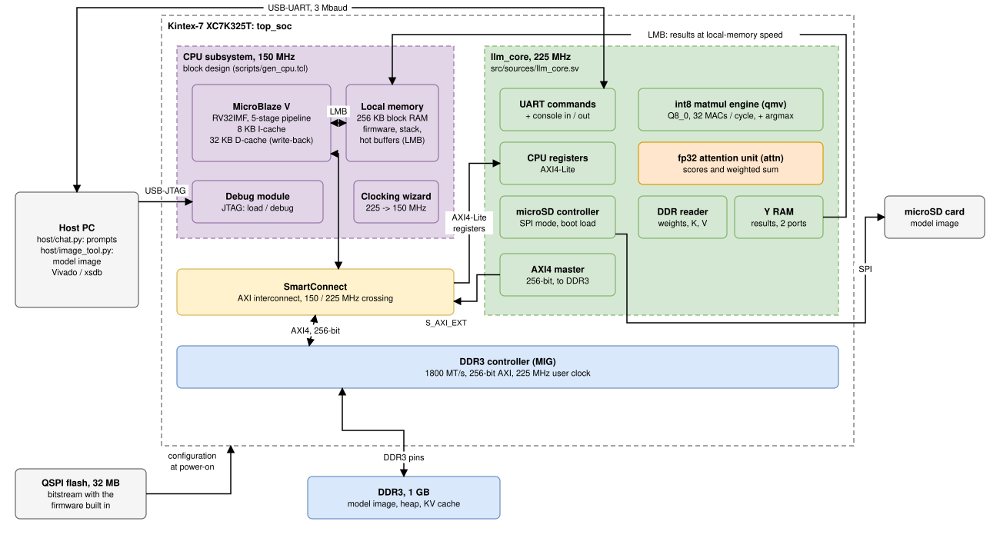

# LLM on FPGA

Karpathy's [llama2.c](https://github.com/karpathy/llama2.c) TinyStories
models (int8 "Q8_0", starting with stories15M) run entirely on a Digilent
Genesys 2 board (Kintex-7 `xc7k325tffg900-2`).

- **Fast.** The board generates about **165 tokens/s**: faster than
  llama2.c's bit-exact build on one core of a Ryzen 7 3700X (108 tokens/s).
- **Bit-exact.** Every step's logits are bit-identical to an x86 build of
  the same forward pass, which is in turn bit-identical to llama2.c's
  `runq.c`.
- **Standalone.** The board boots from its flash, loads the model from its
  microSD card, and takes prompts over the USB-UART.



## How it works

**The CPU.** A MicroBlaze V soft CPU (RV32IMF, 150 MHz) runs `runq.c`'s
forward pass, ported to `fw/`. It starts jobs on four units in the fabric,
all at 225 MHz on the DDR3 controller's clock.

**The fabric units:**
- an **int8 matrix-vector engine**, which does every matmul, streaming the
  weights from DDR3 at one 32-byte beat per cycle;
- an **fp32 attention unit** with 8 lanes, for the scores and weighted
  sums over the KV cache;
- an **fp32 vector unit**, for quantize, SwiGLU, softmax and copies;
- a **DMA** that writes the KV cache.

**Bit-exact float.** Every float unit rounds like the CPU, and every sum
adds its terms in `runq.c`'s order. The results are therefore the same bits
as the software.

**The limit.** Each token streams 17 MB of weights from DDR3, so memory
bandwidth sets the ceiling, at roughly 400 tokens/s.


## Quick start

These steps assume the tools from [docs/getting_started.md](docs/getting_started.md):
Vivado 2026.1, Python with numpy and pyserial, and a Genesys 2 with a
microSD card.

```sh
git submodule update --init
python3 -m venv .venv && source .venv/bin/activate && pip install -r requirements.txt

mkdir -p models && curl -L -o models/stories15M.bin \
  https://huggingface.co/karpathy/tinyllamas/resolve/main/stories15M.bin
ref/build_ref.sh                                       # Q8_0 model + golden data
python3 host/build_image.py models/stories15M_q80.bin \
    third_party/llama2.c/tokenizer.bin models/stories15M.img

source /tools/Xilinx/2026.1/Vivado/settings64.sh
make TOP=top_soc program_fw                            # build, then load over JTAG
python3 host/image_tool.py upload models/stories15M.img --store   # once per model
python3 host/chat.py                                   # type a prompt
```

`make TOP=top_soc flash` writes the design to the board's QSPI flash. With
the mode jumper on QSPI, the board then boots by itself.

## Documentation

Everything is in [docs/](docs/README.md):

| Page | Covers |
|---|---|
| [Getting started](docs/getting_started.md) | tools, setup, build, run, check bit-exactness |
| [System design](docs/system_design.md) | the system as a whole: partitioning, clocks, memories, job model, numerics, boot, verification, limits, resources, decisions |
| [Performance](docs/performance.md) | measurements, limits, speed history, desktop comparison |
| [Data formats](docs/data_formats.md) | model image, microSD card, qmv DDR format, KV cache, trace lines |
| Hardware | [llm_core](docs/hardware/llm_core.md) (UART protocol, registers), [matmul engine](docs/hardware/qmv.md), [attention](docs/hardware/attn.md), [vector unit](docs/hardware/vpu.md), [float units](docs/hardware/float_units.md), [microSD](docs/hardware/sd_ctrl.md), [CPU subsystem](docs/hardware/cpu_subsystem.md), [top levels and pins](docs/hardware/top_levels.md) |
| [Firmware](docs/firmware.md) | model code and hooks, board overrides, console commands, other programs |
| [Host tools](docs/host_tools.md) | `chat.py`, `image_tool.py`, `llm_host`, test scripts |
| [Reference](docs/reference.md) | the llama2.c golden and the numpy reference |
| [Build](docs/build.md) | Vivado flow, make targets, programming, flashing |
| [Simulation](docs/simulation.md) | Verilator testbenches and vector generators |
| [Troubleshooting](docs/troubleshooting.md) | known issues and fixes |

## Designs

| `TOP` | What | Speed |
|---|---|---|
| `top_soc` | the full system: MicroBlaze V + `llm_core` + DDR3 | 165 tokens/s |
| `top_llm` (default) | no CPU; the PC runs the model and sends each matmul over the UART | 0.7 tokens/s |
| `top_qmv` | the matmul engine alone, weights over the UART | |
| `top_gemm` | an int8 systolic array GEMM, kept for batched prompt processing | |

## Status

Done and measured on the board (stories15M, greedy): 165 tokens/s, every
step bit-exact. See [performance.md](docs/performance.md) for where the time
goes.

- [ ] Power-on boot from the QSPI flash (needs a power cycle on site with
      the mode jumper on QSPI; rebooting from the flash over JTAG works)
- [ ] Bigger models: stories42M, stories110M (export them with
      `--group-size 32`, see
      [system_design.md](docs/system_design.md#14-where-to-go-from-here))
- [ ] Optional speed-ups: RMSNorm and RoPE on the vector unit (~200
      tokens/s), a hardware job list per layer (~230-250)
- [ ] Measure power

## Credits

- `third_party/llama2.c`: Andrej Karpathy's llama2.c, the reference
  implementation and the source of the models and tokenizer.
- `board_support/`: Digilent's board files and master XDC.
