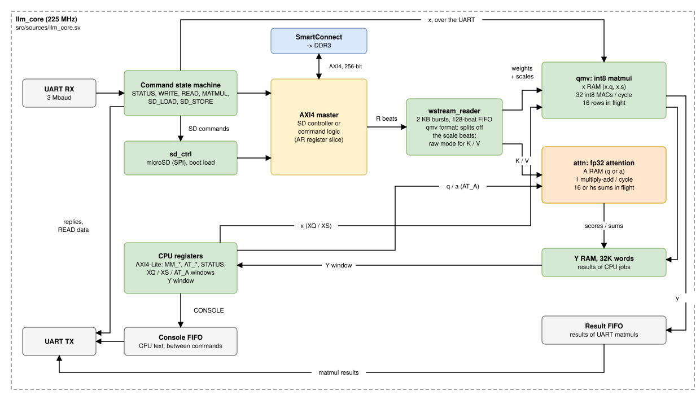
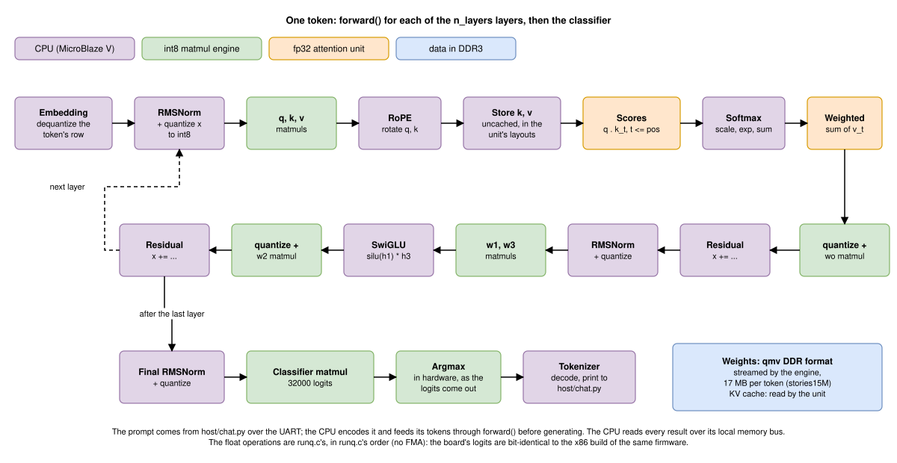
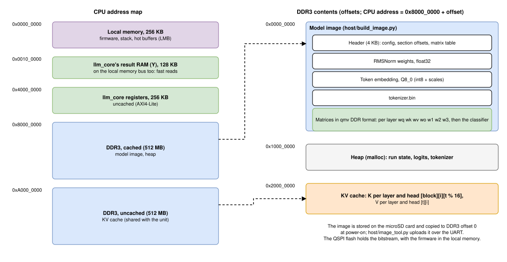

# LLM on FPGA

Goal: run a Llama 2-architecture model (Karpathy's llama2.c TinyStories
models, starting with stories15M) on a Digilent Genesys 2 board (Kintex-7
`xc7k325tffg900-2`), using llama2.c's int8 "Q8_0" format.

Current state: stories15M runs entirely on the board. A MicroBlaze V soft
CPU on the FPGA runs `runq.c`'s forward pass (`fw/`). In the fabric, an int8
matrix-vector engine does every matmul, streaming the weights from DDR3, an
fp32 attention unit computes the attention scores and weighted sums, and an
fp32 vector unit does quantize, SwiGLU and softmax. The design and firmware
boot from the board's flash, the model loads from a microSD card in the
board's slot, and prompts come from the PC over the USB-UART
(`host/chat.py`). Greedy generation runs at about 165 tokens/s, faster than
llama2.c's bit-exact build on one core of a desktop CPU, and
every step's logits are bit-identical to an x86 build of the same firmware.
That x86 build, with the C library's math functions instead of the
firmware's, is bit-identical to llama2.c's `runq.c`.

- `top_soc`: MicroBlaze V + engine + DDR3 + microSD (the full system).
- `top_llm` (default): the same without the CPU. The host PC runs the
  model (`host/llm_host.c`) and sends one matmul at a time over the
  USB-UART (0.7 tokens/s, set by USB round trips).
- `top_qmv`: the same engine with the weights sent over the UART (no DDR).
- `top_gemm`: `Y = A @ B + C` on an N×N int8 systolic array, kept for
  prompt processing later.

## Architecture

**[docs/system_design.md](docs/system_design.md)** describes the system as a
whole: hardware / software split, clocks and crossings, memories, the job
model, numerics, boot, verification, the time budget and its limits, and
resources. Its diagrams: [clocks](docs/diagrams/clocks.drawio.svg),
[time per token](docs/diagrams/budget.drawio.svg),
[boot](docs/diagrams/boot.drawio.svg),
[verification](docs/diagrams/verification.drawio.svg).


The diagrams in `docs/diagrams/` are `.drawio.svg` files: GitHub shows them as
images, and draw.io (or the VS Code draw.io extension) opens them for
editing.

### Quantized matrix-vector engine (`qmv.sv`)

Computes `y = W @ x` exactly as `runq.c`'s `matmul()` does: for each row, per
group of 32 (or 64) inputs, an int32 dot product of int8 values, then
`val += ((float)ival * w_scale) * x_scale` in float32, in group order. The
float units (`fp32_mul`, `fp32_add`, `int_to_fp32`) round to nearest even
like the CPU, which is what makes the results bit-exact. They flush
subnormals to zero, a range these values never reach.

`x` sits in on-chip RAM; `W` streams in at 32 bytes per beat (the DDR3
interface width, for later) with each beat's group scale. Each row's float
sum is a chain of dependent adds, so the engine works on 16 rows
round-robin to hide the adder pipeline and takes a beat every cycle. The host
lays `W` out in that order: `qmv_stream()` in `ref/q80.py`.

`top_qmv` protocol (1 Mbaud): the host sends `n`, `d` (u16), `x.q`, `x.s`,
then the weight beats (32 int8 + float32 scale each); the FPGA streams back
`d` float32 results as they are computed. See `src/sources/top_qmv.sv`.

### Attention unit (`attn.sv`)

For one head, the two float loops of `runq.c`'s attention: the scores
`q · k_t` for every timestep, then the weighted sum `Σ a_t v_t` once the CPU
has done the softmax. Each sum adds its terms in `runq.c`'s order on the
engine's fp32 units, so the results are bit-exact. K and V stream from DDR3
through the weight reader, a 32-byte beat per cycle into 8 multiply-add
lanes. K is stored in blocks of 128 timesteps, transposed, so each lane has
16 independent sums in flight to hide the adder's latency. Each layer's k
and v are written into the KV cache by a DMA job from the vector unit's RAM
(K's words 512 bytes apart, with byte strobes).

### Vector unit (`vpu.sv`)

The float work between the matmuls, with the firmware's operations in the
firmware's order, so the results are the same bits:

- QUANT: a vector into the matmul engine's x RAM as Q8_0 groups (max, scale
  = max / 127, round half away from zero)
- SILU: SwiGLU on the w1 and w3 results, `(a · 1 / (1 + e^-a)) · b`
- SOFTMAX: scale the scores, max, `exp`, a sequential sum, divide, straight
  into the attention unit's A RAM
- COPY: q into the attention unit

It streams elements through a pipelined divider (`fp32_div.sv`, correctly
rounded) and an exp pipeline (`fp32_exp.sv`, the firmware's `m_expf` step by
step on the fp32 units), reading the matmul results in the Y RAM and its own
8K-word V RAM, which the CPU also reaches over its local memory bus. The
CPU's part of a layer is now RMSNorm, RoPE, the residual adds and starting
the jobs.

### `top_llm`: DDR3, commands, microSD

- DDR3 controller (`mig_ddr3`, generated from Digilent's preset by
  `scripts/gen_ip.tcl`): 1800 MT/s, 256-bit AXI at 225 MHz. Everything else
  runs on its 225 MHz clock.
- `llm_core.sv`: UART command interface at 3 Mbaud: STATUS, WRITE / READ
  DDR, MATMUL (W streamed from DDR by `wstream_reader.sv`, x sent with the
  command), SD_LOAD, SD_STORE.
- `sd_ctrl.sv`: microSD in SPI mode. SD_STORE copies a DDR region to the card
  (image, then a header with a checksum, written last); SD_LOAD copies it
  back and checks it. SD_LOAD also runs by itself after power-on.

Weights sit in DDR in "qmv DDR format": the engine's beat order in chunks of
8 beats, each one beat of 8 float32 group scales and then the 8 weight
beats.

### `top_soc`: MicroBlaze V



- CPU block design (`scripts/gen_cpu.tcl`): MicroBlaze V, RV32IMF with a
  single-precision FPU, at 150 MHz from its own clocking wizard (its
  pipeline doesn't close at 225 MHz). 256 KB of local block RAM holds the
  firmware, stack and hot buffers. A data cache covers DDR3. The
  SmartConnect crosses to the 225 MHz side.
- `llm_core` is shared: the UART command set still works, and the CPU drives
  the engine through registers (x in, start, see `llm_core.sv`), with its
  console on the same UART (output, and prompts in with the CONSOLE_IN
  command). The result RAM is also on the CPU's local memory bus, so
  results come back at local-memory speed, and the classifier's argmax is
  computed in hardware as the logits come out.
- Address map (CPU): local memory at 0, `llm_core`'s result RAM at
  `0x0010_0000`, `llm_core`'s registers at `0x4000_0000`, DDR3 at
  `0x8000_0000` (cached up to `0x9FFF_FFFF`, uncached above).





The **model image** (`host/build_image.py`) is what the firmware reads, laid
out as it sits in DDR3:
- a header with the config and section offsets
- the RMSNorm weights, the Q8_0 token embedding and `tokenizer.bin`
- every matrix in qmv DDR format

`fw/model/` is `runq.c`'s forward pass, tokenizer and greedy sampler over
that image, in `runq.c`'s float operation order (no FMA). `fw/model/mathf.c`
has float-only `expf` / `sincosf` that give the same bits on the board's FPU
as on x86, so `fw/build/golden` (the x86 build) is an exact golden for the
board.

### Systolic array (`systolic_array.sv`)

A weight-stationary systolic array of N×N processing elements (PEs). `B` is loaded into the PEs first and stays there. Then `A` flows in from the left and partial sums flow down from the top, starting at `C`. Rows of `Y` come out at the bottom, one per cycle.

`top_gemm` protocol (115200 baud): the host sends `A`, `B`, `C` (N·N bytes
each, row-major); the FPGA sends back `Y` (N·N little-endian int32,
row-major).

### Both tops

If the host stops partway through a job for 100 ms, the job is dropped, so a
crashed host script can't leave the board out of step. LEDs: 0 heartbeat,
1-3 job phase, 7:4 completed jobs (mod 16). CPU RESET resets the design.

## Required software

| Tool                             | Version                          | Used for                             |
| -------------------------------- | -------------------------------- | ------------------------------------ |
| Vivado (Basic license is enough) | 2026.1                           | synthesis, implementation, bitstream |
| Verilator                        | 5.x (tested with 5.020, 5.052)   | simulation; needs `--timing` support |
| zlib headers (`zlib1g-dev`)      | any                              | Verilator FST waveform traces        |
| Python                           | 3.x + `numpy`, `pyserial`        | test vectors, host script            |
| GNU Make, Bash                   | any recent                       | build and sim scripts                |

Hardware: Digilent Genesys 2 FPGA board.

## Setup

```sh
git submodule update --init

python3 -m venv .venv
source .venv/bin/activate
pip install -r requirements.txt
```

`board_support/` holds Digilent's board files and master XDC as submodules.
The constraints this design uses are in `src/constrs/genesys2.xdc`.
`third_party/llama2.c` is Karpathy's llama2.c, used as the golden reference.

## Golden reference (`ref/`)

```sh
mkdir -p models && curl -L -o models/stories15M.bin \
  https://huggingface.co/karpathy/tinyllamas/resolve/main/stories15M.bin
ref/build_ref.sh                 # quantize, build runq_dump, dump golden data
python3 ref/check_ref.py         # check the numpy reference against it
```

- `export_q80.py`: numpy port of llama2.c's Q8_0 export (no PyTorch needed);
  writes `models/stories15M_q80.bin` (group size 32, since 288 isn't a
  multiple of 64).
- `runq_dump.c`: runs `runq.c` greedily and dumps the logits of every step
  plus every `matmul()` call at one position (43 for stories15M: 6 layers ×
  7, plus the classifier) to `ref/build/stories15M/`.
- `q80.py`: numpy reference. `matmul()` and `quantize()` are bit-exact with
  `runq.c`; `forward()` is close but not exact (numpy's float sums and
  `exp`/`sqrt` differ by an ulp now and then, and once one tips an
  activation across a rounding boundary the KV cache carries it), so
  `runq.c` itself stays the full-model golden.

## Simulation (Verilator)

```sh
sim/run_qmv.sh                          # engine + top_llm core (needs ref/build_ref.sh)
sim/run_tb.sh tb_sd_ctrl sdhc -GSdhc=1  # microSD controller (also -GSdhc=0)
sim/run_verilator.sh 2 4 16             # systolic array alone
TB=tb_top_gemm sim/run_verilator.sh 2 4 16   # top_gemm through the UART pins
```

`run_qmv.sh` runs:

1. `tb_fp32`: the float units against numpy float32, on 100k vectors
   including exact rounding ties, and the exp pipeline against the
   firmware's `m_expf` (`sim/gen_qmv.py fp`)
2. `tb_qmv`: the engine on real `runq.c` matmuls (layer 0 wq, w1, w2 and the
   32000-row classifier) plus a random group-size-64 one, every output
   checked bit-exact, with random stalls in the weight stream
3. `tb_top_qmv`: `top_qmv` through its UART pins, including the idle timeout
4. `tb_llm_core`: `llm_core` (everything but the DDR controller and the
   CPU) against an AXI memory model and an SD card model: every command,
   real matmuls from "DDR", an SD store / load round trip, and the CPU side:
   matmuls, attention, vector unit and DMA jobs through the registers

`sim/run_attn.sh` and `sim/run_vpu.sh` test the attention unit and the
vector unit on their own, every result bit-exact.

`src/sim/` also has the models: `axi_mem_model.sv` (AXI4 memory with random
stalls) and `sd_card_model.sv` (SPI-mode SDHC / SDSC card with random
delays, which also flags protocol violations). `sim/fake_board.py` is the
whole command set in software on a pseudo-terminal, for testing host
programs without the board.

`run_verilator.sh` regenerates the GEMM vectors with `sim/gen_stim.py` (`iden`:
`A` = identity, `C` = 0, so `Y = B`; `rand`: all random) and runs the chosen
testbench per size. `sim/run_tb.sh <tb> <tag> [-G...]` builds and runs any
single testbench. The top-level testbenches run the UART at 8 clocks per bit
to keep the sims short.

## FPGA build (Vivado)

```sh
source /tools/Xilinx/2026.1/Vivado/settings64.sh

make                 # top_llm: DDR controller IP (first time), synth -> impl -> bitstream
make TOP=top_qmv     # or top_gemm
make impl            # stop after place and route
make synth           # stop after synthesis
make program         # load the bitstream over the JTAG USB port (not to flash)
```

Each stage reruns only when its inputs have changed. Output goes to
`build/<TOP>/`: checkpoints, logs, and the utilization and timing reports.
`top_llm` meets timing at 225 MHz, `top_soc` at 225 MHz plus 150 MHz for the
CPU, the others at 200 MHz. `make TOP=top_soc` also generates the CPU block
design.

## Running on the board

Plug in both micro-USB ports: **PROG** (JTAG) and **UART**. Your user needs
to be in the `dialout` group.

```sh
make program
host/build_host.sh                       # once (needs ref/build_ref.sh)

# first time, or for a new model: upload the weights (~1 min) and store
# them on the microSD card (~7 s); this overwrites the card
ref/build/llm_host models/stories15M_q80.bin third_party/llama2.c/tokenizer.bin \
    "Once upon a time" 64 ref/build/run -u -s

# afterwards the board loads them from the card at power-on, and llm_host
# skips the upload; -v also checks every matmul against the CPU
ref/build/llm_host models/stories15M_q80.bin third_party/llama2.c/tokenizer.bin \
    "Once upon a time" 64 ref/build/run -v
cmp ref/build/run/logits.bin ref/build/stories15M/logits.bin   # identical

python3 host/sd_tool.py status           # SD / DDR status
python3 host/ddr_test.py                 # DDR memory test + matmuls from DDR
```

### `top_soc`: the model on the board's CPU

```sh
python3 host/build_image.py models/stories15M_q80.bin \
    third_party/llama2.c/tokenizer.bin models/stories15M.img
make TOP=top_soc program_fw              # bitstream with the firmware built in
# once per model (~2 min): DDR over the UART, then the microSD card
python3 host/image_tool.py upload models/stories15M.img --store

python3 host/chat.py                     # type prompts, the board writes stories
python3 host/chat.py --steps 100 "Tom and his dog"

# check against the x86 golden: every step's token and logits, bit for bit
make -C fw golden
python3 host/chat.py --trace "Once upon a time" > run.txt
fw/build/golden models/stories15M.img "Once upon a time" 256 /tmp > golden.txt
grep '^T ' run.txt | diff - golden.txt   # identical
```

Other firmware (`make -C fw`) is loaded over JTAG onto a running `top_soc`
(`make TOP=top_soc program`): `xsdb scripts/run_fw.tcl fw/build/bringup.elf`
tests the CPU, FPU, DDR3 and the engine; `fw/build/membench.elf` measures
memory latency (output: `python3 host/console.py`).

**Standalone:** `make TOP=top_soc flash` writes that bitstream to the
board's QSPI flash (erasing what was there). With the mode jumper on QSPI,
the board then boots by itself at power-on: it configures from the flash,
loads the model from the microSD card (~7 s) and waits for prompts from
`host/chat.py`. The flash now holds this design (written 2026-11-18). After
writing, the FPGA was rebooted from the flash over JTAG and worked; a boot
from an actual power cycle has not been tried yet.

## Performance: the FPGA vs a desktop CPU

stories15M (int8), greedy, prompt "Once upon a time", generating until the
story ends. Board: `host/chat.py`, timed by the firmware. Host: llama2.c's
`runq.c` on an AMD Ryzen 7 3700X (8 cores, up to 4.4 GHz, gcc 13), median of
7 runs, at the same length as the board's story (168 tokens).

| Platform | Build | tokens/s |
|---|---|---|
| FPGA board: MicroBlaze V at 150 MHz, engine, attention and vector units at 225 MHz | this repo | **165** |
| Ryzen 7 3700X, 1 thread | `runq.c`, `gcc -O2` (bit-exact build) | 108 |
| Ryzen 7 3700X, 1 thread | `runq.c`, `gcc -Ofast -march=native` | 250 |
| Ryzen 7 3700X, 8 threads | `runq.c`, `-Ofast -march=native -fopenmp` | 1465 |

The board is 1.5x faster than the desktop's bit-exact build on one core,
at a ~30x lower clock; the desktop's fastest single-thread build is 1.5x
faster than the board, and all eight cores about 9x. The board's 6.1 ms per
token: matmuls 3.1 ms (the engine streams 17 MB of weights per token from
DDR3, about 2.7 ms at the memory's bandwidth), attention 1.2 ms (with the
KV cache writes), and ~1.8 ms on the CPU (RMSNorm 0.6, RoPE 0.4, starting
jobs and moving vectors). Without the accelerators, the MicroBlaze V alone
would manage about 1 token/s. Power wasn't measured.

How the board's speed developed (same model and prompt, a fixed 256 tokens
with `--trace`; the first row: 64). Tracing copies all 32,000 logits out of
the result RAM every token (~1.3 ms) and the KV cache gets longer, so these
are slower than the 168-token story above:

| Step | tokens/s |
|---|---|
| Host PC runs the model, one matmul at a time over the USB-UART (`top_llm`) | 0.7 |
| MicroBlaze V runs the model, matmuls on the engine | 4.7 |
| Hot buffers in local memory; attention loops overlapped | 7.3 |
| 5-stage CPU pipeline, 32 KB write-back data cache | 11.3 |
| fp32 attention unit | 19.7 |
| Results over the local memory bus, argmax in hardware | 27.5 |
| Firmware: independent float work overlapped (same bits) | 36.4 |
| fp32 vector unit: quantize, SwiGLU, softmax | 94.1 |
| 8-lane attention unit; KV cache by DMA; q by the vector unit | 116.3 |
| DMA writes in flight; RoPE / residuals unrolled | 128.3 |
| Weight reader: 512-beat FIFO, 8 reads in flight | 132.1 |

## Status and next steps

Measured on the board (stories15M, greedy, `host/chat.py`): about 165
tokens/s for a full story (the time per token above). Streaming the
weights from DDR3 alone takes ~2.5 ms per token, so this board tops out
around 400 tokens/s with bit-exact int8 weights; what is left is estimated
at ~1.5x for considerable RTL work (see
[docs/system_design.md](docs/system_design.md#9-performance-and-what-limits-it)).

- [ ] Power-on boot from the QSPI flash (needs a power cycle on site; the
      mode jumper must be on QSPI)
- [ ] Bigger models: stories42M, stories110M (the microSD card has room)
- [ ] Optional speed-ups: RMSNorm and RoPE on the vector unit (~200
      tokens/s), a hardware job list per layer (~230-250)
- [ ] Measure power

`top_qmv` and `top_gemm` have their own host scripts: `host/qmv_uart.py`,
`host/gemm_uart.py`.
