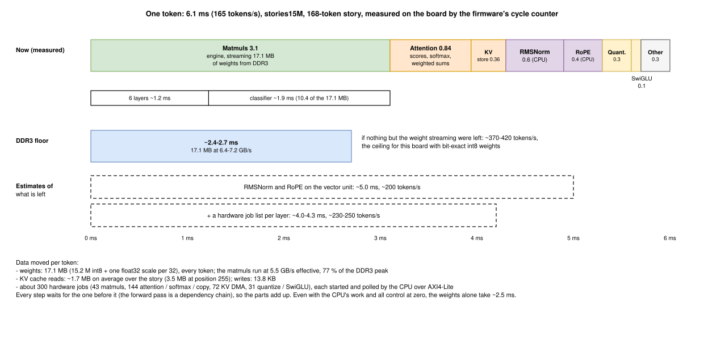

# Performance

All figures are for stories15M (int8 Q8_0), greedy decoding, prompt "Once
upon a time", measured on the board by the firmware unless noted. Every run
listed is bit-exact against the golden.

## Current numbers

**Generation speed:** 164.9 tokens/s for a full 168-token story, 6.06 ms per
token.

| Part | ms per token | Done by |
|---|---|---|
| Matmuls | 3.1 | matmul engine (DDR3-bound) |
| Attention: scores, softmax, sums | 0.84 | attention unit + vector unit |
| KV cache writes | 0.36 | DMA |
| RMSNorm | 0.6 | CPU |
| RoPE | 0.4 | CPU |
| Quantize | 0.3 | vector unit (+ the CPU copying x into the V RAM) |
| SwiGLU | 0.1 | vector unit |
| Other | 0.3 | CPU: embedding, residuals, job starts and polling |

**Startup:** about 7 s from configuration to `READY`, almost all of it the
SD card load.

## How it's measured

- The firmware times each part with `llm_core`'s CYCLES counter (225 MHz).
  Printing and tracing are left out of the total.
- The statistics line comes after each story
  ([firmware.md](firmware.md#console-protocol)).
- Story runs stop at BOS, so the number of tokens depends on the story: 168
  here.
- `--trace` runs always generate `steps` tokens. They also copy all 32,000
  logits per token out of the Y RAM for the hash, about 1.3 ms per token
  counted under "matmul". The KV cache also grows longer than in a story.
  That is why the 256-token speed history below is slower than the story
  figure: 132.1 vs 164.9 tokens/s with the same hardware.

## Limits

Each token streams every weight once: **17.1 MB**.

| Part of the 17.1 MB | Size |
|---|---|
| 15.2 M int8 values | 15.2 MB |
| float32 group scales (one per 32 values) | 1.9 MB |
| of which the classifier | 10.4 MB |

**DDR3 peak:** 32 bits × 1800 MT/s = 7.2 GB/s. That is also exactly one
32-byte beat per 225 MHz cycle, the rate the engine consumes.

**Floor:** 17.1 MB / 7.2 GB/s = 2.4 ms per token, or about 2.7 ms at a
realistic 6.4 GB/s. The matmuls take 3.1 ms: 5.5 GB/s effective, 77 % of
peak.

**Ceiling:** about 370-420 tokens/s, even if everything else were free.
- Fewer bytes would need a smaller weight format, which would break
  bit-exactness.
- On-chip storage can't help much. About 1.4 MB of block RAM is free, and
  the 10.4 MB classifier can't be cached.

**KV cache traffic:** about 1.7 MB per token on average over the story
(3.5 MB at position 255), plus 13.8 KB of writes.

**Control:** about 300 jobs per token:

| Jobs | Count |
|---|---|
| Matmuls | 43 |
| COPY, scores, softmax and weighted sum per head | 144 |
| KV DMA | 72 |
| Quantize and SwiGLU | 31 |

Each job costs several register accesses at about 37 CPU cycles each,
roughly 0.5 ms per token in total.

**Serialization:** the forward pass is a dependency chain, and the CPU
starts one job at a time, so the per-part times add up.

**What is left** (estimates, not built):

| Change | ms per token | tokens/s |
|---|---|---|
| RMSNorm and RoPE on the vector unit | ~5.0 | ~200 |
| + a hardware job list per layer | ~4.0-4.3 | ~230-250 |
| + prefetching the next matrix during non-matmul work | approaches ~3.5 | |

Each of these is considerable RTL and verification work for a shrinking
gain. The design is within about 2× of what this memory system allows.

## Compared with a desktop CPU

llama2.c's `runq.c` on an AMD Ryzen 7 3700X (8 cores, up to 4.4 GHz, gcc
13). Median of 7 runs, at the same length as the board's story (168
tokens).

| Platform | Build | tokens/s |
|---|---|---|
| FPGA board: MicroBlaze V at 150 MHz, units at 225 MHz | this repo | **165** |
| Ryzen 7 3700X, 1 thread | `runq.c`, `gcc -O2` (the bit-exact build) | 108 |
| Ryzen 7 3700X, 1 thread | `runq.c`, `-Ofast -march=native` | 250 |
| Ryzen 7 3700X, 8 threads | `runq.c`, `-Ofast -march=native -fopenmp` | 1465 |

- The board is 1.5× faster than the desktop's bit-exact build on one core,
  at a ~30× lower clock.
- The fastest single-thread desktop build is 1.5× faster than the board.
  All eight cores are about 9× faster.
- Without the accelerators, the MicroBlaze V alone would manage about 1
  token/s.
- Power wasn't measured.

## Speed history

Same model and prompt, a fixed 256 tokens with `--trace` (the first row: 64
tokens):

| Step | tokens/s |
|---|---|
| Host PC runs the model, one matmul at a time over the USB-UART (`top_llm`) | 0.7 |
| MicroBlaze V runs the model, matmuls on the engine | 4.7 |
| Hot buffers in local memory; attention loops overlapped | 7.3 |
| 5-stage CPU pipeline, 32 KB write-back data cache | 11.3 |
| fp32 attention unit | 19.7 |
| Results over the local memory bus, argmax in hardware | 27.5 |
| Firmware: independent float work overlapped (same bits) | 36.4 |
| fp32 vector unit: quantize, SwiGLU, softmax | 94.1 |
| 8-lane attention unit; KV cache by DMA; q by the vector unit | 116.3 |
| DMA writes in flight; RoPE / residuals unrolled | 128.3 |
| Weight reader: 512-beat FIFO, 8 reads in flight | 132.1 |

The same steps as full stories (168 tokens), from the vector unit on:

| Step | tokens/s |
|---|---|
| fp32 vector unit | 118.1 |
| 8-lane attention, DMA, COPY | 142.5 |
| DMA in flight, CPU unrolling | 159.1 |
| Reader FIFO 512 | 164.9 |

**What each step removed:**
- **USB round trips** (`top_llm`): about 16-20 ms per matmul from the FTDI
  latency timer.
- **CPU attention and softmax:** about 85 ms per token at first, on a CPU
  that took ~14 cycles per multiply-add.
- **Reading 32,000 logits through the SmartConnect:** ~37 cycles each,
  replaced by the local-bus port and the hardware argmax.
- **Quantize and SwiGLU on the CPU:** 8.5 ms per token, now on the vector
  unit.
