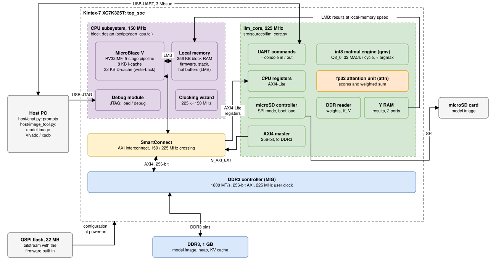
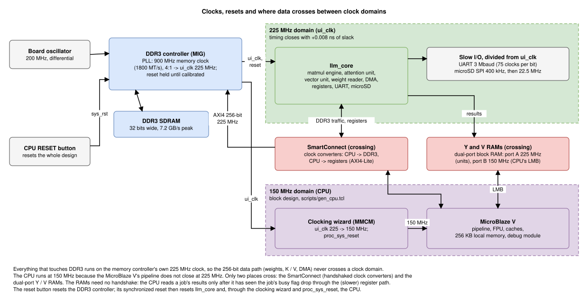
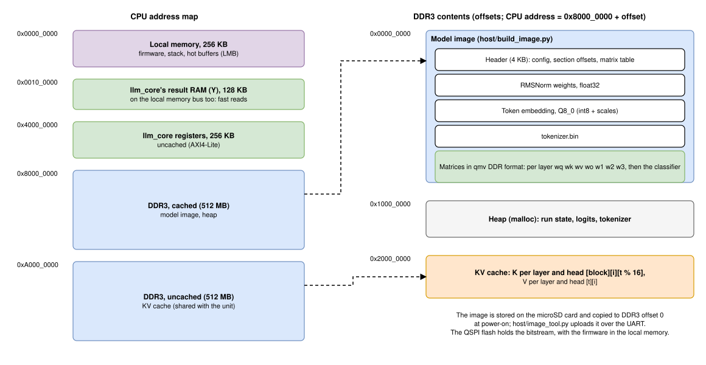
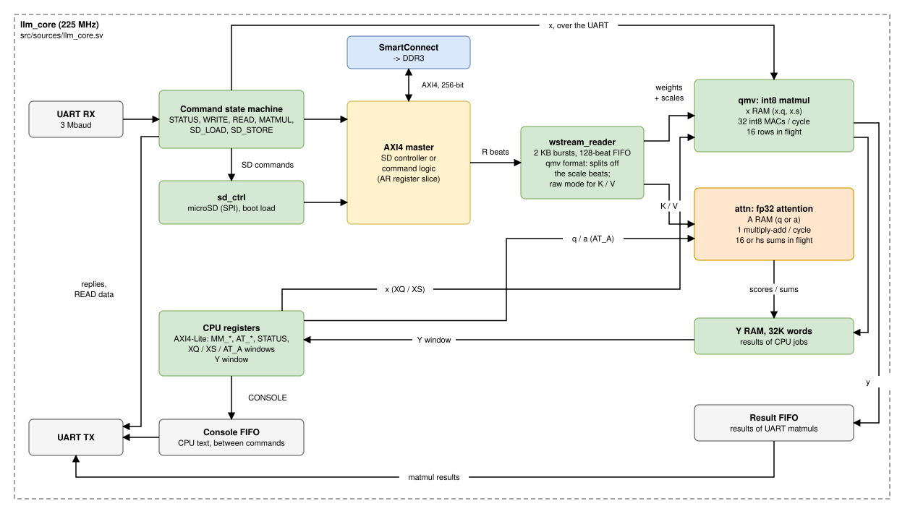
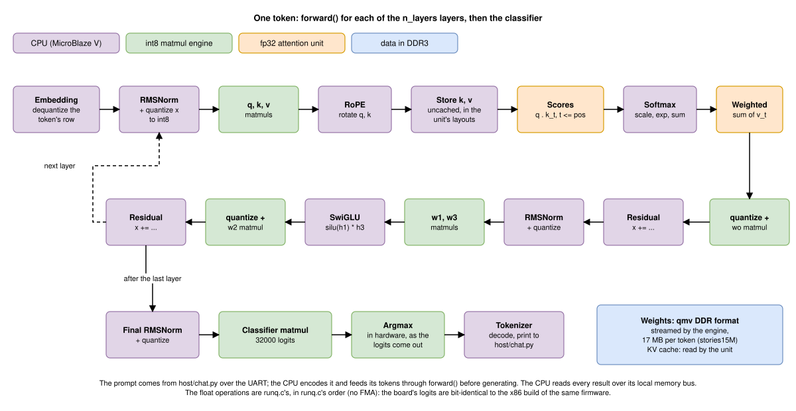
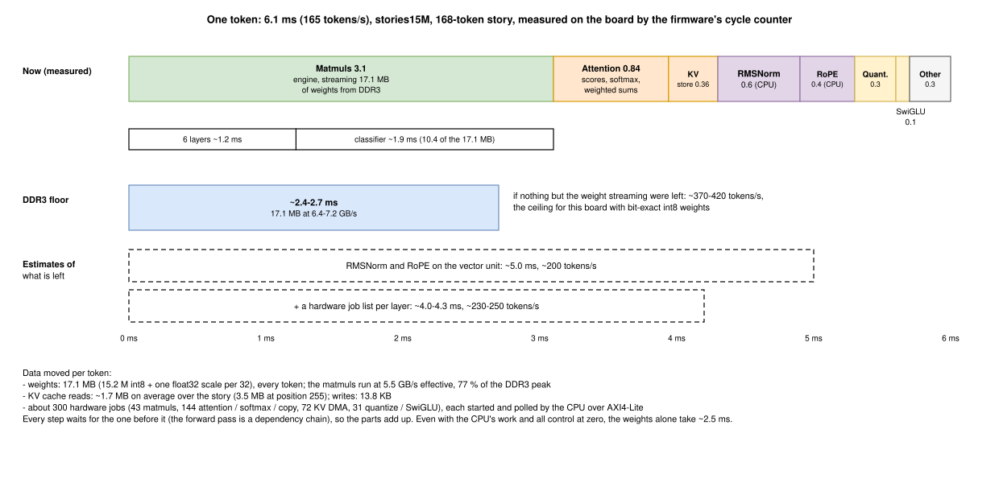
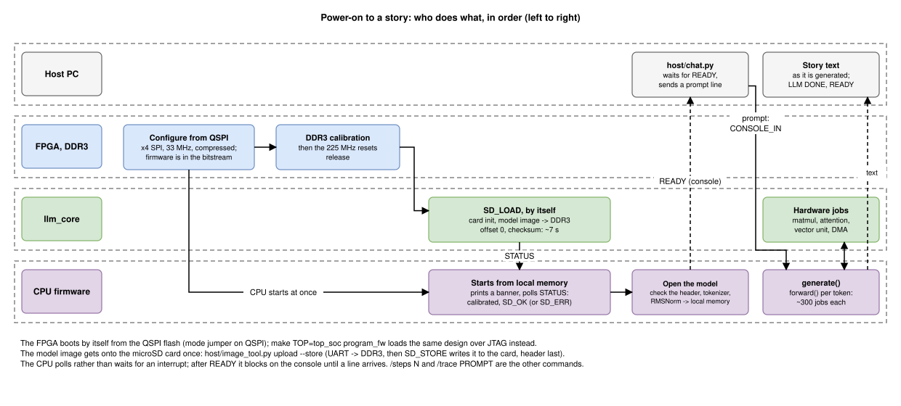
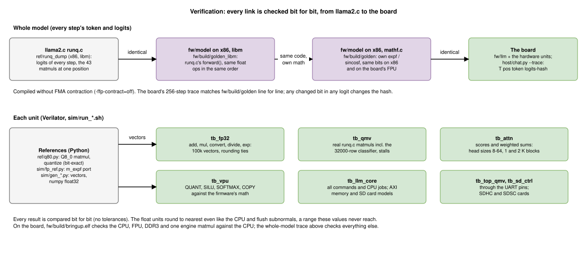

# System design: llama2.c on the Genesys 2

This document describes the whole system: what runs where, how data and
control move, the clocks, the memories, the boot, how correctness is
checked, and where the time goes. For how each unit works inside, see the
pages in [hardware/](README.md#all-pages) and the comments at the top of
each source file.

All numbers are for stories15M (int8 Q8_0, greedy decoding) on the board,
measured on 2026-11-18 unless noted otherwise.

## 1. Goal and requirements

- Run Karpathy's llama2.c TinyStories models (stories15M first) on a
  Digilent Genesys 2 (Kintex-7 `xc7k325tffg900-2`) with llama2.c's int8
  "Q8_0" weights.
- **Bit-exact:** every step's logits must be bit-identical to an x86 build
  of the same forward pass. That build, with the C library's math functions,
  is bit-identical to llama2.c's `runq.c`. "Close enough" is not accepted,
  because one rounding difference changes the KV cache and every later
  token.
- **Standalone:**
  - the board boots from its own flash;
  - it loads the model from its microSD card;
  - it takes prompts over the USB-UART.
- **As fast as the board allows.** Result: **165 tokens/s**, 6.1 ms per
  token. That is 1.5× llama2.c's bit-exact build on one core of a Ryzen 7
  3700X. The DDR3 bandwidth floor is about 2.5 ms per token (section 9).

## 2. System context

There are four external parts:

| Part | Role |
|---|---|
| Host PC | Prompts in and story text out over the USB-UART (`host/chat.py`); model upload (`host/image_tool.py`); Vivado and JTAG for development |
| QSPI flash (32 MB) | The bitstream, with the firmware built into the CPU's local memory |
| microSD card | The model image (header, weights, tokenizer), loaded into DDR3 at power-on |
| DDR3 (1 GB, 32-bit, 1800 MT/s) | The model image, the CPU's heap and the KV cache |

There are two main blocks on the FPGA:
- **The CPU subsystem** is a MicroBlaze V block design. It runs the
  model's control flow.
- **`llm_core`** holds the accelerators, their RAMs, the UART, the microSD
  controller and the DDR3 master.

## 3. Hardware / software partitioning

The forward pass is llama2.c's `runq.c` `forward()`. Work moved into the
fabric only where it paid. All of the work below runs in `runq.c`'s order
with the same float operations.

| Work | Where | Why there |
|---|---|---|
| Matmuls (43 per token) | `qmv`, int8 matmul engine | ~98 % of the arithmetic; bounded by streaming the weights from DDR3 |
| Attention scores and weighted sums | `attn`, 8-lane fp32 unit | Reads the whole KV cache every layer; on the CPU it took 8 ms per token |
| Softmax, quantize, SwiGLU, copying q | `vpu`, fp32 vector unit | `exp` and divide are slow on the soft CPU's FPU (quantize + SwiGLU took 8.5 ms per token) |
| KV cache writes | DMA in `llm_core` | Scattered word writes (K is stored transposed) |
| Argmax of the 32,000 logits | `qmv`, while the logits come out | Saves reading the logits back |
| RMSNorm, RoPE, residual adds, embedding | CPU | Small (0.6 + 0.4 + 0.3 ms); candidates for the vector unit (section 9) |
| Tokenizer, sampling, the job sequence, the console | CPU | Control flow; easy to change in C |

**The CPU is the system's sequencer.** It starts every hardware job through
registers and polls for completion. Keeping control in C made bring-up and
bit-exact debugging straightforward: any hook can fall back to the CPU code
in `fw/model/`. It costs about 0.5 ms of register traffic per token
(section 9).

The firmware is split along the same line:
- **`fw/model/`** is the portable model, the same source for x86 and the
  board. It has weak hooks: `mm_quant`, `ffn_hidden`, `att_store_kv`,
  `att_head`, `fast_calloc` and others.
- **`fw/llm/`** overrides those hooks with hardware jobs.

## 4. Clocks, resets and clock-domain crossings

| Clock | Frequency | Source | Drives |
|---|---|---|---|
| `sysclk` | 200 MHz | board oscillator | the DDR3 controller's PLL |
| DDR3 | 900 MHz (1800 MT/s) | MIG PLL | DDR3 PHY |
| `ui_clk` | 225 MHz | MIG, 4:1 | `llm_core`, the SmartConnect's DDR3 side, the MIG's AXI port |
| CPU | 150 MHz | clocking wizard from `ui_clk` | MicroBlaze V, local memory, caches, debug |

**One clock for the data path.**
- Everything that touches DDR3 runs on the controller's own `ui_clk`. The
  256-bit data path (weights, K/V, DMA) therefore never crosses a clock
  domain.
- One 32-byte beat per 225 MHz cycle is exactly the DDR3 peak (7.2 GB/s).
  The matmul engine (32 int8 MACs per cycle) and the attention unit (8 fp32
  multiply-adds per cycle) were sized to consume exactly that.

**Why two clocks.** The MicroBlaze V's pipeline does not close timing at
225 MHz, so it runs at 150 MHz. Only two places cross between the clocks:
- **SmartConnect:** handshaked clock converters for the CPU's DDR3 and
  register traffic.
- **The Y and V RAMs:** true dual-port block RAM, with the units on port A
  at 225 MHz and the CPU's local memory bus on port B at 150 MHz. These need
  no handshake. The CPU only reads a job's results after it has seen the
  job's busy flag drop through the register path, which is slower than the
  RAM path.

**Reset.** The CPU RESET button resets the DDR3 controller. The
controller's synchronized reset, released after calibration, resets
`llm_core` directly. It also resets the CPU, through the clocking wizard and
`proc_sys_reset`.

**Timing.** The 225 MHz domain closes with +0.008 ns of worst slack after
the stronger implementation directives and a post-route `phys_opt`. A
faster `llm_core` clock is not available; the DDR3 interface fixes it
anyway.

## 5. Memory architecture

### On-chip

| Memory | Size | Clock(s) | Holds | Who uses it |
|---|---|---|---|---|
| CPU local memory (LMB) | 256 KB (64 RAMB36) | 150 | firmware, stack, a 48 KB arena for the run state's small buffers, RMSNorm weights | CPU, single cycle |
| D-cache / I-cache | 32 KB write-back / 8 KB | 150 | DDR3 at `0x8000_0000`-`0x9FFF_FFFF` | CPU |
| Y RAM | 32K words (128 KB) | 225 / 150 | matmul results (w1 at 0, w3 at 8192), attention scores and sums | units write; vector unit and CPU (LMB) read |
| V RAM | 8K words (32 KB) | 225 / 150 | vectors: x for quantize, SwiGLU output, softmax scratch, k / v / q staging | CPU writes and reads over the LMB; vector unit; DMA source |
| `qmv` x RAM | 64 × 32 B + 64 scales | 225 | the quantized input vector | CPU registers or the vector unit's QUANT |
| `attn` A RAM | 4K words | 225 | q (scores) or the softmax weights (weighted sum) | vector unit (COPY, SOFTMAX) |
| Weight reader FIFO | 512 beats (16 KB, LUT RAM) | 225 | weight, K and V beats in flight | between DDR3 and the units |

### DDR3

DDR3 holds three regions, at these offsets:

| Offset | Region | Contents |
|---|---|---|
| `0x0000_0000` | Model image | `host/build_image.py`; details below |
| `0x1000_0000` | Heap | the run state, the logits for tracing, the tokenizer's tables |
| `0x2000_0000` | KV cache | written by DMA, read by the attention unit |

The model image is laid out as:
- a 4 KB header (config, section offsets, matrix table);
- the RMSNorm weights;
- the Q8_0 token embedding;
- `tokenizer.bin`;
- every matrix in "qmv DDR format": the engine's beat order, in chunks of
  one beat of 8 scales followed by 8 weight beats.

The KV cache is laid out per layer and KV head, each slot 4 KB aligned:
- **K:** blocks of 128 timesteps, each block `[i][t % 128]`. A 32-byte beat
  holds 8 timesteps' element `i`, so each attention lane has 16 independent
  sums in flight.
- **V:** rows `[t][i]`.

The CPU sees DDR3 at `0x8000_0000` (cached) and `0xA000_0000` (uncached).
The engine and the DMA use DDR3 offsets.

## 6. Control: the job model

The CPU drives `llm_core` through AXI4-Lite registers at `0x4000_0000`
(`fw/common/llm_hw.h`, `src/sources/llm_core.sv`):

| Job | Registers | Inputs and outputs |
|---|---|---|
| Matmul | `MM_ADDR`, `MM_ND`, `MM_YOFF`, `MM_START`; `ARGMAX` | weights from DDR3 × x RAM → Y RAM at `MM_YOFF`; argmax of the results |
| Attention | `AT_ADDR`, `AT_CFG` (hs, nt), `AT_START` (0 scores, 1 weighted sum) | K or V from DDR3 × A RAM → Y RAM |
| Vector unit | `VPU_N`, `VPU_SRC`, `VPU_SRC2`, `VPU_DST`, `VPU_F`, `VPU_OP` (starts) | Y / V RAM → V RAM, x RAM or A RAM |
| DMA | `DMA_SRC`, `DMA_N`, `DMA_DST`, `DMA_STRIDE`, `DMA_START` | V RAM → DDR3: whole beats for stride 4, single words with byte strobes otherwise; up to 15 writes in flight |
| Console | `CONSOLE`, `CONSOLE_IN` | text to the UART; prompt bytes from the host (UART command `0x06`) |
| Status | `STATUS` (calibrated, SD state, busy, console), `CYCLES` | |

How the job model works:
- **One job at a time.** `STATUS` bit 8 is the busy flag for every job
  type. The CPU writes the parameters, writes the start register, then polls
  `STATUS` until busy drops.
- **No interrupts.**
- **No overlap between jobs.** Correctness never depends on overlap.

A token takes about 300 jobs:

| Jobs | Count |
|---|---|
| Matmuls | 43 |
| COPY, scores, SOFTMAX and weighted sum per head | 144 |
| KV DMA | 72 |
| Quantize and SwiGLU | 31 |

Each register access through the SmartConnect costs about 37 CPU cycles.

The UART command set (`STATUS`, `WRITE`, `READ`, `MATMUL`, `SD_LOAD`,
`SD_STORE`, `CONSOLE_IN`) works alongside the CPU. It is used for the model
upload and by the CPU-less `top_llm` build.

## 7. One token

For each of the 6 layers, in order:

1. RMSNorm on the CPU; x goes to the V RAM and the vector unit quantizes it
   into the x RAM.
2. q, k, v matmuls.
3. RoPE on the CPU.
4. k, v, q go to the V RAM, and DMA writes k and v into the cache.
5. For each head: COPY q to the attention unit, then scores, SOFTMAX into
   the A RAM, and the weighted sum. The CPU reads the head's output over
   the LMB.
6. Quantize, the wo matmul and the residual add.
7. RMSNorm, quantize, then the w1 and w3 matmuls.
8. SILU and quantize on the vector unit (the data never touches the CPU),
   then the w2 matmul and the residual add.

After the last layer:
- the final RMSNorm;
- the 32,000-row classifier matmul;
- the hardware argmax, which gives the next token.

## 8. Numerics: why the results are bit-exact

- **Same operations, same order.** The firmware's float operations are
  `runq.c`'s, in `runq.c`'s order. It is compiled with
  `-ffp-contract=off`, so no FMA contraction happens. Unrolling and
  overlapping in the firmware only reorder independent operations.
- **Own transcendental functions.** `expf` and `sincosf` come from
  `fw/model/mathf.c`. They are float-only, so they give the same bits on
  x86 and on the board's FPU. The hardware's `fp32_exp` is the same
  algorithm, step by step.
- **The hardware rounds like the CPU.**
  - Every fp32 unit rounds to nearest even.
  - The divider is correctly rounded.
  - Quantize rounds half away from zero, like `roundf`.
- **Hardware sums keep the C loop's order.** Every sum the hardware
  computes starts from +0 and adds its terms in the same index order as the
  C loop. Parallelism comes only from running independent sums side by
  side: 16 rows in the engine, 8 lanes × 16 sums in the attention unit.
- **Subnormals are flushed to zero.** The values in this model never reach
  that range. `fp32_exp`'s subnormal results are the one known difference
  from `m_expf`, and they don't occur either.

## 9. Performance, and what limits it

Measured on the board (168-token story, firmware cycle counter):

| Part | ms per token | Limited by |
|---|---|---|
| Matmuls | 3.1 | DDR3: 17.1 MB of weights per token, at 5.5 GB/s effective (77 % of peak) |
| Attention: scores, softmax, sums | 0.84 | KV reads, job round trips, softmax's sequential sum |
| KV cache writes | 0.36 | 72 DMA jobs, mostly single-word writes |
| RMSNorm | 0.6 | the CPU's sequential float adds (6-cycle FPU latency) |
| RoPE | 0.4 | CPU |
| Quantize, SwiGLU | 0.4 | vector unit, plus copying x into the V RAM |
| Other | 0.3 | embedding, residuals, job start and polling |
| **Total** | **6.06** (165 tokens/s) | |

**The ceiling is DDR3 bandwidth.**
- Each token must stream every weight once. That is 17.1 MB, of which the
  32,000-row classifier is 10.4 MB.
- At the DDR3's 7.2 GB/s peak, that takes at least 2.4 ms. At a realistic
  6.4 GB/s it takes 2.7 ms.
- Even with all other work at zero, the design cannot exceed roughly
  370-420 tokens/s while keeping bit-exact int8 weights.
- Weight compression or smaller formats would change the results, so they
  are ruled out.
- On-chip caching can't hold the classifier: about 1.4 MB of block RAM is
  free.

**Everything is serialized.**
- The forward pass is a dependency chain: each step needs the previous
  step's output.
- The CPU sits idle during matmuls, and the engine sits idle during
  RMSNorm.
- Per-step costs therefore add up.

**What is left** (estimates, not built):

| Change | ms per token | tokens/s |
|---|---|---|
| RMSNorm and RoPE on the vector unit | ~5.0 | ~200 |
| + a hardware job list per layer instead of ~300 CPU-started jobs | ~4.0-4.3 | ~230-250 |
| + prefetching the next matrix during non-matmul work | approaches ~3.5 | |

Each step adds RTL and verification effort for a diminishing return. The
design is within about 2× of what this memory system allows. A clearly
bigger gain needs more memory bandwidth, which this board doesn't have.

**About the 256-token figures.** The speed history in
[performance.md](performance.md#speed-history) uses fixed
256-token runs with `--trace`. Tracing copies all 32,000 logits out of the
Y RAM every token to hash them, about 1.3 ms counted under "matmul". It also
reads a longer KV cache. Those runs show 132 tokens/s (7.6 ms per token)
for the same hardware.

**Compared with the host** (Ryzen 7 3700X, `runq.c`, 168 tokens):

| Build | tokens/s |
|---|---|
| `-O2`, bit-exact | 108 |
| `-Ofast -march=native` | 250 |
| 8 threads | 1465 |

The board runs at a clock about 30× lower than the desktop's.

## 10. Boot and operation

1. **Configure from flash.** The FPGA configures from the QSPI flash: ×4
   SPI at 33 MHz, compressed bitstream (`src/constrs/genesys2.xdc`). The
   firmware is part of the bitstream (`make TOP=top_soc fwbit` runs
   `updatemem`).
2. **CPU and DDR3 start.** The CPU starts at once from local memory. In
   parallel, the DDR3 controller calibrates.
3. **Model load.** `llm_core` starts `SD_LOAD` by itself: card
   initialization at 400 kHz, then 22.5 MHz SPI reads. It copies the image
   to DDR3 offset 0 and checks the header checksum. This takes about 7 s.
4. **Firmware setup.** The firmware polls `STATUS` until DDR3 is calibrated
   and the load has finished. It then:
   - checks the model header;
   - opens the tokenizer;
   - copies the RMSNorm weights into local memory;
   - allocates the run state;
   - prints `READY`.
5. **Prompts.** `host/chat.py` sends a prompt line with the `CONSOLE_IN`
   command. The firmware generates and prints the story, then prints
   `LLM DONE` and `READY` again. Two special commands:
   - `/steps N` sets the number of steps;
   - `/trace PROMPT` prints a per-step hash of the logits.

Getting the model onto the card is a one-time step:
`host/image_tool.py upload --store`. It sends the image over the UART into
DDR3, then `SD_STORE` writes it to the card with the header last.

**Open item:** a boot from an actual power cycle hasn't been tried yet.
Rebooting from the flash over JTAG works. The mode jumper must be on QSPI.

## 11. Verification

**Whole model.** The chain is:

`runq.c` (`ref/runq_dump`) == `fw/build/golden_libm` → `fw/build/golden` == the board.

- The two `==` links are compared bit for bit.
- The middle step swaps in the firmware's own math functions.
- The board's `--trace` output is a 256-step `T pos token logits-hash`
  list. It matches `fw/build/golden` line for line.

**Units.** Verilator testbenches compare every result bit for bit against
Python references:
- `ref/q80.py`;
- `sim/fp_ref.py`, a numpy port of `m_expf`;
- the `sim/gen_*.py` vector generators.

| Script | Covers |
|---|---|
| `sim/run_qmv.sh` | float units (100k vectors including rounding ties), engine on real `runq.c` matmuls, `top_qmv` through its pins, `llm_core` with AXI memory and SD card models |
| `sim/run_attn.sh` | attention unit: head sizes 8-64, one and two K blocks |
| `sim/run_vpu.sh` | each vector unit op |
| `sim/run_tb.sh tb_sd_ctrl` | microSD controller with SDHC and SDSC card models |

**On the board.** `fw/build/bringup.elf` checks:
- the CPU;
- the FPU's bit patterns;
- cached and uncached DDR3;
- an engine matmul against the CPU.

## 12. Resources

Post-route `top_soc`, from `report_utilization -hierarchical`:

| Block | LUTs | FFs | RAMB36 | DSP |
|---|---|---|---|---|
| `llm_core` total | 22.2k | 18.1k | 44 | 50 |
| ├ vector unit (`vpu`) | 8.1k (exp 4.8k, divide 1.9k) | 8.2k | 0 | 28 |
| ├ attention unit (`attn`) | 4.2k | 4.3k | 4 | 16 |
| ├ weight reader (512-beat FIFO) | 3.6k (2.7k as LUT RAM) | 0.5k | 0 | 0 |
| ├ matmul engine (`qmv`) | 3.2k | 2.0k | 0.5 | 4 |
| ├ microSD controller | 1.4k | 0.7k | 0 | 0 |
| └ Y / V RAMs, registers, FIFOs, UART | 1.7k | 2.4k | 40 | 2 |
| CPU block design total | 21.7k | 25.7k | 85 | 6 |
| ├ SmartConnect | 13.9k | 22.0k | 0 | 0 |
| ├ MicroBlaze V | 7.7k | 3.4k | 21 | 6 |
| └ local memory, debug | 0.1k | | 64 | |
| DDR3 controller (MIG) | 8.3k | 6.7k | 1 | 0 |
| **Total** (of 203,800 / 407,600 / 445 / 840) | **52.7k (26 %)** | **50.5k (12 %)** | **130.5 (29 %)** | **56 (7 %)** |

The device is far from full: 41 % of slices are used. The SmartConnect is
the largest single block. The arithmetic itself is small, because the
design is limited by bandwidth, not compute.

## 13. Design decisions

| Decision | Alternatives | Reason |
|---|---|---|
| Soft CPU as sequencer, accelerators as jobs | Full hardware forward pass | Bring-up and bit-exact debugging in C; any hook falls back to the CPU; most of the speed came anyway |
| fp32 units that match the CPU bit for bit | Fixed point, or fp32 with tree sums | Bit-exact output is a requirement; tree sums would change the rounding |
| Units sized to one 32-byte beat per cycle | Wider compute | DDR3 delivers one beat per cycle at most; more compute would wait |
| K stored transposed in 128-timestep blocks | Rows `[t][i]` like V | Gives each lane 16 independent sums to hide the adder latency without reordering any sum |
| Y and V RAMs on the CPU's local memory bus | Reads through the SmartConnect | A few CPU cycles per word instead of ~37 |
| Hardware argmax on the classifier | Reading 32,000 logits | Saves ~1.3 ms per token |
| CPU at 150 MHz on its own clock | Same clock as `llm_core` | The MicroBlaze V doesn't close at 225 MHz; the 225 MHz data path stays crossing-free |
| Model on microSD, loaded by hardware | Model in flash, or loaded by the CPU | Bigger models fit and swapping a model never touches the flash; the hardware load works without the CPU (and for `top_llm`) |

## 14. Where to go from here

**Throughput:** at most ~1.5× more is available, from the items in
section 9. Each one costs a new unit or sequencer and its verification.

**Better uses of the effort:**
- **Bigger models.** stories42M (47 MB of weights per token) and
  stories110M (123 MB) fit the card and DDR3, and the units' RAMs are large
  enough. Neither has been run yet, and they need one change first. Their
  dims are multiples of 64, so llama2.c's export uses group size 64. The
  build has `GS` = 32, and `model_open` rejects anything else. The simple
  route is to export them with group size 32 (`ref/export_q80.py
  --group-size 32`): `runq.c` reads any group size. Group size 64 would need changes in more than one place. `qmv`
  supports it and passes its group-size-64 test, but the vector unit's
  QUANT and the firmware assume groups of 32.
  Time scales roughly with the weight bytes, so expect about 60 and 25
  tokens/s.
- **Prompt processing in batches.** It would reuse each weight beat across
  several tokens. This is the one way around the bandwidth limit, but it
  only helps the prompt, not generation.
- **Measure power**, for a tokens-per-joule comparison with the desktop.
- **Confirm the power-on boot from flash** on site.
